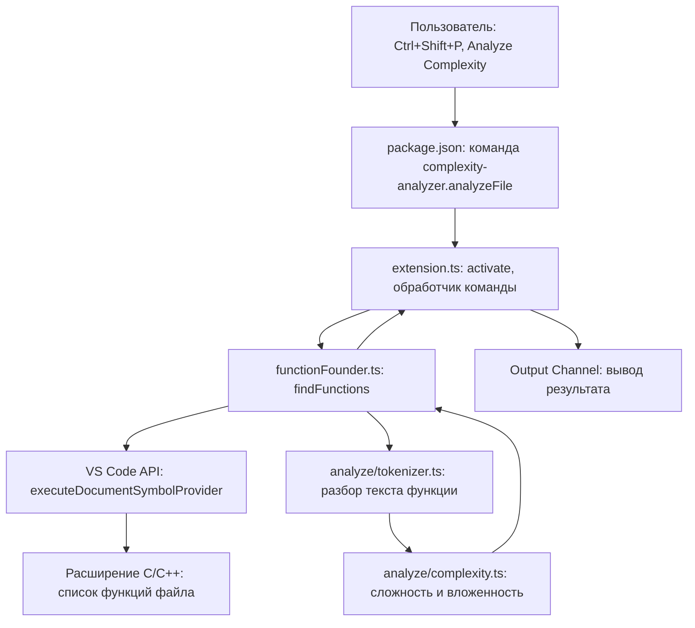

# Complexity Analyzer

**Автор:** [Фамилия Имя Отчество], группа [номер группы]
**Курс:** Инструментальные среды разработки ПО, лабораторная работа №3

## Описание

Плагин для Visual Studio Code, который анализирует функции в C++ файле
и считает для каждой:

- **цикломатическую сложность** (1 + число развилок: `if`, `for`, `while`, `case`, `catch`, `&&`, `||`, `?`);
- **максимальную вложенность** блоков (по стеку фигурных скобок).

Результат выводится в панель Output.

## Возможности

- команда **Analyze Complexity** в палитре команд (Ctrl+Shift+P);
- автоматический поиск всех функций, методов и конструкторов в открытом файле;
- пропуск комментариев и строк при анализе, чтобы слова из них не считались развилками;
- пропуск объявлений функций без тела (прототипов);
- вывод имени функции, номера строки, сложности и вложенности;
- сообщение, если файл не открыт или функции не найдены.

## Требования

- VS Code;
- расширение **C/C++** (Microsoft), которое подсказывает плагину, где в файле функции.

## Пример вывода

TestFunc1(int, int) (строка 1): сложность 2, вложенность 1
TestFunc2(int, int) (строка 9): сложность 6, вложенность 5
TestFunc3(int, int) (строка 30): сложность 6, вложенность 1

## Структура проекта

- `src/extension.ts`: точка входа, регистрация команды;
- `src/functionFounder.ts`: поиск функций через VS Code API;
- `src/analyze/tokenizer.ts`: разбор текста функции на части кода;
- `src/analyze/complexity.ts`: подсчёт сложности и вложенности;
- `src/analyze/types.ts`: общие типы;
- `docs/`: документация, сгенерированная TypeDoc (`npm run docs`).

## Архитектура

## История коммитов

- 2026-10-13: Initial commit
- 2026-10-14: Plugin initialized
- 2026-10-15: tokenizer made
- 2026-10-15: types made
- 2026-10-15: complexity.ts made
- 2026-10-16: all done
- 2026-10-29: Test file edited
- 2026-10-29: JSDocs added
- 2026-10-29: Add TypeDoc documentation
